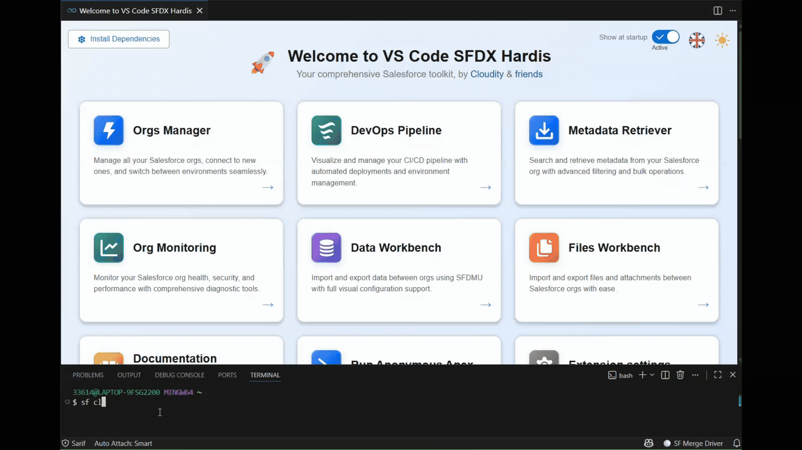

# sf-plugin-hardis-demo

Demo plugin showing how to create a Salesforce CLI plugin that integrates with the [sfdx-hardis](https://github.com/hardisgroupcom/sfdx-hardis) VS Code extension via the **Plugin API**.

## Overview

This repository demonstrates how to build a community plugin for sfdx-hardis that:

- Uses **`uxLog`** to send messages to both the terminal and VS Code extension UI
- Uses **`uxLogTable`** to display tabular data in both the terminal and VS Code extension UI
- Uses **`prompts`** to display interactive prompts in VS Code (with terminal fallback)
- Uses **`WebSocketClient`** to send progress indicators and report file notifications to VS Code
- Uses **`NotifProvider`** to post notifications to Slack, MS Teams, Email, or custom API channels

The WebSocket connection is automatically activated because this plugin lists `sfdx-hardis` in its `dependencies`.



## Getting Started

### Prerequisites

Install both sfdx-hardis and this demo plugin:

```bash
sf plugins install sfdx-hardis
sf plugins install sf-plugin-hardis-demo
```

### Commands

#### `sf cloudity demo`

Run the demo command showing full Plugin API integration.

```bash
# Interactive mode (prompts for action and items)
sf cloudity demo

# CI-friendly: pass --action to skip the action prompt
sf cloudity demo --action someOption

# Pass --items to skip the multi-select items prompt
sf cloudity demo --action someOption --items item1 --items item2

# Multiple items, another action
sf cloudity demo --action anotherOption --items item1 --items item3 --items item5
```

**Flags:**

| Flag       | Short | Description                                                                       |
| ---------- | ----- | --------------------------------------------------------------------------------- |
| `--action` | `-a`  | Action to perform: `someOption` or `anotherOption` (skips the interactive prompt) |
| `--items`  | `-i`  | Items to process — repeatable (skips the interactive multi-select prompt)         |

## Plugin API Usage

```typescript
import { uxLog, uxLogTable, prompts, WebSocketClient, NotifProvider } from 'sfdx-hardis/plugin-api';
import type { PromptsQuestion, NotifMessage } from 'sfdx-hardis/plugin-api';
import c from 'chalk';

// Log to terminal + VS Code extension UI
uxLog('action', this, c.cyan('Starting...'));
uxLog('success', this, c.green('Done!'));

// Display tabular data in terminal + VS Code extension UI
uxLogTable(this, [{ name: 'Item1', status: 'OK' }], ['name', 'status']);

// Interactive prompt (VS Code UI or terminal fallback)
const response = await prompts({
  type: 'select',
  name: 'action',
  message: 'What would you like to do?',
  choices: [
    { title: 'Some option', value: 'someOption' },
    { title: 'Another option', value: 'anotherOption' },
  ],
});

// Progress tracking in VS Code
WebSocketClient.sendProgressStartMessage('Processing', items.length);
WebSocketClient.sendProgressStepMessage(i + 1, items.length);
WebSocketClient.sendProgressEndMessage(items.length);

// Send a report file or URL to the VS Code extension sidebar
WebSocketClient.sendReportFileMessage('/tmp/report.json', 'My Report', 'report');
WebSocketClient.sendReportFileMessage('https://example.com', 'Documentation', 'docUrl');

// Notifications to Slack, Teams, Email, etc.
await NotifProvider.postNotifications({
  text: 'My plugin completed!',
  type: 'DEPLOYMENT',
  severity: 'success',
  logElements: [],
  data: {},
  metrics: {},
});
```

## Development

```bash
# Install dependencies
yarn install

# Build
yarn build

# Run tests
yarn test

# Run the command locally
./bin/dev.js cloudity demo --action someOption --items item1 --items item2
```

## Learn More

- [Creating sfdx-hardis Plugins — Full Guide](https://sfdx-hardis.cloudity.com/creating-plugins/)
- [sfdx-hardis VS Code Extension](https://marketplace.visualstudio.com/items?itemName=NicolasVuillamy.vscode-sfdx-hardis)
- [sfdx-hardis GitHub Repository](https://github.com/hardisgroupcom/sfdx-hardis)
